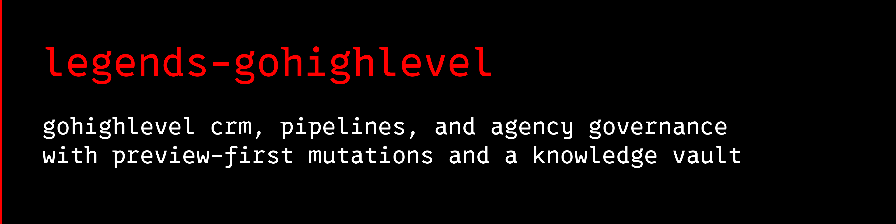

<a name="banner"></a>
<a name="legends-gohighlevel"></a>

# 

[](https://github.com/avalonreset/legends-gohighlevel/releases/latest)
[](https://github.com/avalonreset/legends-gohighlevel/actions/workflows/checks.yml)
[](LICENSE)

**GoHighLevel API v2, Workflows v3, Voice/Conversation AI, Custom Objects, and 5-layer SaaS agency governance CLI with preview-first mutations, API readback, and a reusable knowledge vault.**

Use this Python **GoHighLevel CLI** (`legends-gohighlevel`) with your coding agent to audit and operate GoHighLevel / HighLevel sub-accounts (`subaccount-audit`, pipelines, opportunities, contacts, tags, notes, calendars, free slots, conversations, workflows, Workflows v3 definitions/logs/step-types, forms, surveys, funnels/redirects, custom objects/associations, Voice AI agents/calls, Conversation AI agents, custom fields, and custom values), preview and verify CRM mutations, run live 5-layer agency and dashboard RBAC audits (`live-audit`, `location-unnerf`, `user-unnerf`, `user-sync-locations`, `unlock-dashboards`, `smtp-unlock`, `rebilling-sync`, `pit-list`, `email-domains`), and keep operating history in Markdown that works with Obsidian and [`legends-empire`](https://github.com/avalonreset/legends-empire).

This is an independent open-source project built on the official HighLevel API v2 and Workflows API v3 (`services.leadconnectorhq.com`) and HighLevel's web-app governance endpoints (`backend.leadconnectorhq.com`). HighLevel provides the CRM platform. This module adds a bounded CLI-first workflow, deterministic governance checks, and source-cited runbooks. It is not affiliated with or endorsed by HighLevel Inc.

## Why use this instead of an ambient GoHighLevel MCP server?

Connecting an ambient HighLevel / LeadConnector MCP server exposes hundreds of unreviewed tools and pulls raw customer personal data into agent context. Calling raw endpoints ad hoc leaves agents guessing about 40 location feature flags, 57 V1 boolean permissions, 130 V2 user scopes, Reporting V2 per-dashboard RBAC (`permissionAccess`), `+hubpro` alias location sync, rate-limit headers, Custom SMTP locks, and 4-store + 14-product SaaS Billing v2 rebilling math.

| Need | What this module supplies |
|---|---|
| Inspect CRM, AI, and Workflows v3 without MCP bloat | Deterministic JSON inspection across 20 HighLevel API v2 and v3 resource families with live `X-RateLimit-*` telemetry |
| Audit a sub-account in one command | `subaccount-audit` checks CAN-SPAM/A2P business profile completeness, pipelines, open opportunities, published vs. draft workflows, empty custom values, calendars, forms, funnels, tags, Voice AI, and Conversation AI |
| Audit all 5 agency governance layers in seconds | Live `live-audit` checking 40 location flags, user V1/V2 scopes + worker health + `+hubpro` aliases, Reporting V2 dashboard RBAC, Custom SMTP locks, and 4-store + 14-product SaaS Billing v2 rebilling |
| Un-nerf sub-accounts and users safely | Preview-first `location-unnerf`, `user-unnerf`, `user-sync-locations`, `unlock-dashboards`, `smtp-unlock`, and `rebilling-sync` with immediate readback verification |
| Keep customer PII out of agent context | `contacts`, `conversations`, and `voice-ai-calls` default to PII-lean metadata (`--full` is explicit opt-in) |
| Review before mutating sub-account state | JSON preview with `before` state, `proposed` payload, and a canonical `sha256` confirmation hash |
| Protect agency margins across all 14 metered products | Offline `rebilling-audit` (`1.05x` / `db_markup=5` Stripe fee shield) and live `rebilling-status` / `rebilling-sync` across all 4 HighLevel billing stores |
| Reuse what you learn | Source ledger, operational runbooks, and an attachable `legends.knowledge-pack/v1` vault for [`legends-empire`](https://github.com/avalonreset/legends-empire) |
| Fit the existing ecosystem | One central [`cto-legends`](https://github.com/avalonreset/cto-legends) skill; module instructions loaded on demand |

## Install the GoHighLevel CLI

Python 3.11 or newer. Zero external runtime dependencies and no MCP server.

```sh
git clone https://github.com/avalonreset/legends-gohighlevel.git
cd legends-gohighlevel
python -m pip install .
legends-gohighlevel doctor
```

For live sub-account CRM operations, load `GHL_PIT` (a sub-account Private Integration Token starting with `pit-`, or `GHL_ACCESS_TOKEN`) and `GHL_LOCATION_ID` from your secret manager into the process environment, or configure named sub-account profiles in `~/.config/legends-gohighlevel/config.json` (selectable via `--profile <name>` or `GHL_PROFILE`).

```sh
legends-gohighlevel subaccount-config
legends-gohighlevel doctor --live
legends-gohighlevel subaccount-audit
legends-gohighlevel --profile second-subaccount subaccount-audit
legends-gohighlevel location
legends-gohighlevel pipelines
legends-gohighlevel opportunities --status open --limit 20
legends-gohighlevel calendars
legends-gohighlevel calendar-slots --calendar-id CALENDAR_ID --start-date 1793491200000 --end-date 1793664000000
legends-gohighlevel workflows
legends-gohighlevel workflow-step-types
legends-gohighlevel workflow-inspect --workflow-id WORKFLOW_ID
legends-gohighlevel workflow-logs --workflow-id WORKFLOW_ID --limit 25
legends-gohighlevel forms --limit 50
legends-gohighlevel surveys --limit 50
legends-gohighlevel funnels --include-redirects
legends-gohighlevel tags
legends-gohighlevel objects
legends-gohighlevel object-records --object-key custom_objects.vehicles --limit 20
legends-gohighlevel associations
legends-gohighlevel voice-ai-agents
legends-gohighlevel voice-ai-calls --limit 20
legends-gohighlevel conversation-ai-agents
legends-gohighlevel custom-values
legends-gohighlevel custom-fields
legends-gohighlevel contacts --limit 20
legends-gohighlevel conversations --limit 20
```

## Live 5-layer agency, user scope, dashboard RBAC, SMTP, and rebilling control

For live agency governance over `backend.leadconnectorhq.com`, set `GHL_TOKEN_ID` in the environment or configure `~/.config/legends-gohighlevel/agency.json` (with `company_id`, `worker_ssh`, `worker_container`, and `worker_user_id` for a remote headless worker):

```sh
legends-gohighlevel agency-config
legends-gohighlevel live-audit
legends-gohighlevel agency-locations
legends-gohighlevel agency-users
legends-gohighlevel user-inspect --email user@example.com
legends-gohighlevel dashboard-permissions --all-locations
legends-gohighlevel smtp-status --all-locations
legends-gohighlevel rebilling-status --all-locations
legends-gohighlevel pit-list --location-id LOCATION_ID
legends-gohighlevel email-domains --location-id LOCATION_ID
```

Preview and apply 5-layer remediation across one or all locations:

```sh
# Layer 1: Un-nerf all 40 location.permissions boolean feature flags
legends-gohighlevel location-unnerf --all-locations
legends-gohighlevel location-unnerf --all-locations --apply --confirm-plan SHA256_FROM_PREVIEW

# Layer 2: Un-nerf user V1/V2 scopes and synchronize +hubpro alias locationIds
legends-gohighlevel user-unnerf --email user@example.com
legends-gohighlevel user-unnerf --email user@example.com --apply --confirm-user USER_ID --confirm-plan SHA256_FROM_PREVIEW
legends-gohighlevel user-sync-locations --user-id PRIMARY_USER_ID --from-user-id ALIAS_USER_ID
legends-gohighlevel user-sync-locations --user-id PRIMARY_USER_ID --from-user-id ALIAS_USER_ID \
  --apply --confirm-user PRIMARY_USER_ID --confirm-plan SHA256_FROM_PREVIEW

# Layer 3: Unlock Reporting V2 Default and Custom Dashboard RBAC (account_admin: full, account_user: full)
legends-gohighlevel unlock-dashboards --all-locations
legends-gohighlevel unlock-dashboards --all-locations --apply --confirm-plan SHA256_FROM_PREVIEW

# Layer 4: Unlock Custom SMTP Add Service button at agency and location levels
legends-gohighlevel smtp-unlock --all-locations
legends-gohighlevel smtp-unlock --all-locations --apply --confirm-plan SHA256_FROM_PREVIEW

# Layer 5: Synchronize 1.05x (markup: 5) rebilling across all 4 stores and 14 SaaS Billing v2 products
legends-gohighlevel rebilling-sync --all-locations --markup 5
legends-gohighlevel rebilling-sync --all-locations --markup 5 --apply --confirm-plan SHA256_FROM_PREVIEW
```

## Preview and update sub-account CRM state (`custom-value`, `tag`, `contact`, `opportunity`, `workflow`)

Every sub-account mutation runs in preview mode by default (`writes_sent: 0`) and requires `--apply --confirm-location <locationId> --confirm-plan <sha256>` with immediate post-write API readback verification:

```sh
legends-gohighlevel custom-value-upsert --name "Support Email" --value "help@example.com"
legends-gohighlevel custom-value-upsert --name "Support Email" --value "help@example.com" \
  --apply --confirm-location YOUR_LOCATION_ID --confirm-plan SHA256_FROM_PREVIEW

legends-gohighlevel tag-upsert --name "vip-client"
legends-gohighlevel tag-upsert --name "vip-client" \
  --apply --confirm-location YOUR_LOCATION_ID --confirm-plan SHA256_FROM_PREVIEW

legends-gohighlevel contact-upsert --email "jane@example.com" --first-name "Jane" --tags "vip-client"
legends-gohighlevel contact-upsert --email "jane@example.com" --first-name "Jane" --tags "vip-client" \
  --apply --confirm-location YOUR_LOCATION_ID --confirm-plan SHA256_FROM_PREVIEW

legends-gohighlevel contact-tag --contact-id CONTACT_ID --tags "booked-call"
legends-gohighlevel contact-note --contact-id CONTACT_ID --body "Completed discovery call."
legends-gohighlevel opportunity-update --opportunity-id OPP_ID --status won --monetary-value 2500

legends-gohighlevel workflow-status --workflow-id WORKFLOW_ID --status published
legends-gohighlevel workflow-status --workflow-id WORKFLOW_ID --status published \
  --apply --confirm-location YOUR_LOCATION_ID --confirm-plan SHA256_FROM_PREVIEW
```

## Audit agency rebilling, V2 user scopes, Custom SMTP locks, and dashboard RBAC offline

Run the deterministic governance calculators offline (no credentials required):

```sh
legends-gohighlevel rebilling-audit --wallet-topup 10.00 --markup 5 --location-id LOCATION_ID
legends-gohighlevel scope-audit --role admin --account-type account
legends-gohighlevel smtp-audit --company-id COMPANY_ID --location-id LOCATION_ID
legends-gohighlevel dashboard-audit --location-id LOCATION_ID --dashboard-id DASHBOARD_ID
```

## Knowledge vault and Empire

Start at [wiki/index.md](wiki/index.md) or attach the versioned knowledge pack at [knowledge/gohighlevel/pack.json](knowledge/gohighlevel/pack.json) (`legends.knowledge-pack/v1`). Open this repository folder in Obsidian or read it as plain Markdown.

Use [the Empire integration guide](docs/EMPIRE.md) to keep private workspace inventories, change receipts, and un-nerf audits in an existing project. Installing the module never modifies a personal vault automatically.

## Agent setup (via `cto-legends`)

The module recipe is [docs/AGENT-RECIPE.md](docs/AGENT-RECIPE.md). The vendored `skills/cto-legends/SKILL.md` is an unchanged copy of the central router. Do not register a separate GoHighLevel skill.

With the central [`cto-legends`](https://github.com/avalonreset/cto-legends) router:

```sh
cto-legends sync
cto-legends sync --apply
cto-legends install legends-gohighlevel
cto-legends install legends-gohighlevel --apply
cto-legends handoff legends-gohighlevel
cto-legends run legends-gohighlevel -- doctor
```

## Architecture and project layout

```text
Operator / Agent
  -> legends-gohighlevel CLI (sub-account plane + agency governance plane)
  -> Sub-account API v2 & Workflows v3 (services.leadconnectorhq.com via GHL_PIT / config.json)
  -> Internal agency backend (backend.leadconnectorhq.com via GHL_TOKEN_ID / remote worker_ssh)
  -> Plan builder (before-state snapshot + proposed payload + SHA-256 hash)
  -> Explicit confirmation (--apply --confirm-location/--confirm-user --confirm-plan)
  -> Single write request + immediate post-write API readback verification
```

- `legends_gohighlevel/`: Zero-dependency Python 3.11+ CLI (`cli.py`), dual-plane HTTP transport (`api.py`), sub-account CRM/AI/Workflows v3 operations (`crm.py`), 5-layer agency backend auditing and remediation (`agency.py`), deterministic governance calculators (`governance.py`), and sanitized social bridge (`social.py`).
- `wiki/` and `knowledge/gohighlevel/`: Source-cited runbooks (`agency-governance.md`, `internal-backend-and-dashboards.md`, `authentication.md`, `crm-operations.md`, `email-and-deliverability.md`, `troubleshooting.md`) and attachable [`legends-empire`](https://github.com/avalonreset/legends-empire) knowledge pack (`pack.json`).
- `docs/`: Agent recipe, Empire integration guide, release readiness, catalog candidate, and [search strategy](docs/SEARCH-STRATEGY.md).

## FAQ

**Can sub-account owners use `legends-gohighlevel` without agency backend access?**
Yes. Sub-account owners only need a sub-account Private Integration Token (`GHL_PIT`, starting with `pit-`) and `GHL_LOCATION_ID` (or `~/.config/legends-gohighlevel/config.json` with optional `--profile <name>`). All 20 sub-account inspection and CRM mutation commands (`subaccount-audit`, `pipelines`, `opportunities`, `contacts`, `tags`, `calendars`, `calendar-slots`, `workflows`, `workflow-inspect`, `voice-ai-agents`, `conversation-ai-agents`, `objects`, `custom-values`, and preview-first mutations) run directly against `services.leadconnectorhq.com`.

**Does `legends-gohighlevel` modify CRM records, workflows, or agency settings immediately?**
No. Every mutation command (`custom-value-upsert`, `custom-value-delete`, `tag-upsert`, `tag-delete`, `contact-upsert`, `contact-tag`, `contact-note`, `opportunity-update`, `workflow-status`, `location-unnerf`, `user-unnerf`, `user-sync-locations`, `unlock-dashboards`, `smtp-unlock`, and `rebilling-sync`) defaults to a read-only preview (`writes_sent: 0`) that returns the `before` state, `proposed` payload, and a canonical `sha256` hash. Writes execute only when repeated with `--apply` and the matching `--confirm-plan <sha256>`.

**Why does a sub-account show a locked dashboard or missing features even when the user has admin scopes?**
HighLevel enforces permissions across five independent layers: location-level feature flags (`location.permissions`), user V1 boolean flags and V2 scopes (`scopes` + `scopesAssignedToOnly`), Reporting V2 per-dashboard RBAC (`permissionAccess`), two-level Custom SMTP locks (`blockAddSmtp`), and 4-store SaaS Billing v2 rebilling. Run `legends-gohighlevel live-audit` to inspect all five layers across every sub-account in one pass.

## Boundaries and verification

```sh
python -m unittest discover -s tests -v
python scripts/check_release.py
```

Exit codes: `0` completed inspection, preview, governance audit, or verified change; `1` operational failure; `2` invalid CLI syntax. A failed write or readback can mean remote state changed: inspect it before retrying.

See [compatibility and verification](docs/RELEASE-READINESS.md), [search positioning](docs/SEARCH-STRATEGY.md), [contributing](CONTRIBUTING.md), [security](SECURITY.md), and [attribution](THIRD_PARTY_NOTICES.md). MIT licensed.

---

**Specification & benchmarks on cto-legends.com:**
- **Module specification & architecture matrix:** [cto-legends.com/modules/legends-gohighlevel](https://cto-legends.com/modules/legends-gohighlevel)
- **Related engineering dispatches:** [How to Build AI Agents: Production CLI & MCP Routing](https://cto-legends.com/blog?post=how-to-build-ai-agents-cli-mcp-routing) · [Claude Code Skills: MCP vs CLI Workflow Architecture](https://cto-legends.com/blog?post=claude-code-skills-mcp-vs-cli-workflow) · [Fractional CTO Advisory: Technical Due Diligence Guide](https://cto-legends.com/blog?post=fractional-cto-technical-due-diligence-guide)
- **Ecosystem hub:** [cto-legends.com/home](https://cto-legends.com/home)
