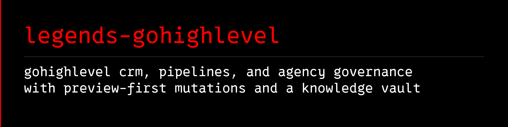
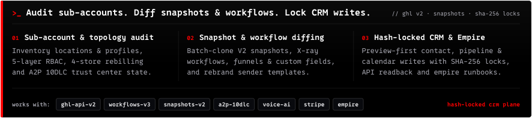
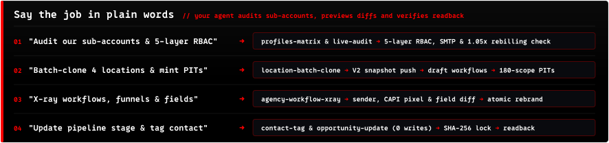
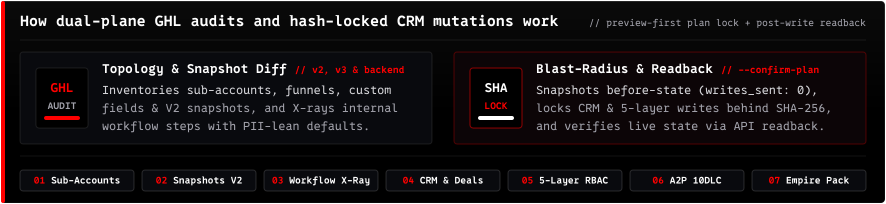
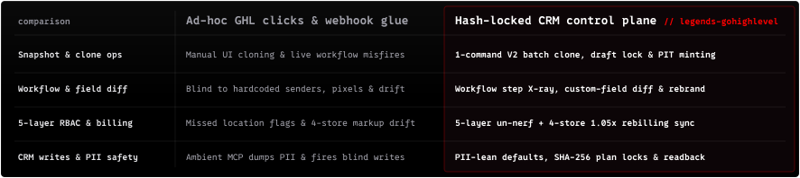

<a name="banner"></a>
<a name="legends-gohighlevel"></a>

# 

[](https://github.com/avalonreset/legends-gohighlevel/releases/latest)
[](https://github.com/avalonreset/legends-gohighlevel/actions/workflows/checks.yml)
[](pyproject.toml)
[](legends_gohighlevel/cli.py)
[](LICENSE)

**Zero-dependency GoHighLevel (GHL) API v2, Workflows v3, Snapshots V2 batch cloning, workflow step X-ray, and 5-layer agency governance CLI (`legends-gohighlevel`) for coding agents: inventory sub-account topologies and custom fields, diff snapshots and funnels, rebrand internal workflow step templates atomically, enforce SHA-256 plan locks with immediate API readback across CRM and pipeline mutations, and attach source-cited revops runbooks to [`legends-empire`](https://github.com/avalonreset/legends-empire).**


```text
Install or update legends-gohighlevel via cto-legends (https://github.com/avalonreset/cto-legends): run `cto-legends install legends-gohighlevel --apply`, then `cto-legends handoff legends-gohighlevel` and follow the returned JSON recipe to verify `legends-gohighlevel doctor`.
```



## Why `legends-gohighlevel` exists

Managing GoHighLevel sub-accounts and agency snapshots through manual browser clicks, brittle webhook glue, or ambient MCP servers fails in three predictable ways:

1. **Snapshot pushes leak old client brand strings, sender emails, and live workflow triggers:** Pushing an agency snapshot or updating surface-level custom values leaves hardcoded `from_name`, `from_email`, reply-to addresses, and Meta Conversion API (`pixel_id`) tokens buried inside internal workflow step templates (`workflowData.templates`), while cloned workflows left in `published` state can fire test messages before cutover.
2. **Hidden 5-layer permission locks and 4-store SaaS rebilling drift:** HighLevel splits access across 40 location feature flags (`location.permissions`), 57 V1 boolean user switches, 130 V2 OAuth scopes, Reporting V2 per-dashboard RBAC (`permissionAccess`), and two-level Custom SMTP locks (`blockAddSmtp`), while spreading `1.05x` SaaS usage markups across 4 separate internal billing stores and 14 metered products.
3. **Ambient MCP servers dump raw customer PII and fire unconfirmed CRM writes:** Connecting a persistent HighLevel or LeadConnector MCP daemon exposes hundreds of unreviewed tools, pulls raw customer phone numbers and transcripts into agent context, and lets an unguided prompt overwrite contacts, opportunities, or custom fields without a before-state diff or post-write check.

`legends-gohighlevel` replaces UI guesswork and MCP bloat with a **110-command, dual-plane Python CLI** that pairs naturally with [`legends-stripe`](https://github.com/avalonreset/legends-stripe) and [`legends-empire`](https://github.com/avalonreset/legends-empire). Routine contact, conversation, and Voice AI inspections default to PII-lean metadata, and every CRM, pipeline, snapshot, rebrand, or governance mutation begins as a zero-write preview (`writes_sent: 0`) locked behind a canonical `sha256` confirmation hash and verified via immediate post-write API readback.

## Ask in plain english

Once [`cto-legends`](https://github.com/avalonreset/cto-legends) is installed, you ask your coding agent in plain english. It audits sub-account topology or agency governance state first, builds a zero-write preview with a SHA-256 confirmation hash, waits for your approval, and verifies the live readback:



## Architecture: dual-plane GHL inspection and hash-locked CRM mutations



### 1. Sub-account and location topology inventory, 5-layer RBAC, and A2P 10DLC trust center

`legends-gohighlevel` operates across both the **Sub-Account Operator plane** (`services.leadconnectorhq.com` via `GHL_PIT` or named profiles in `~/.config/legends-gohighlevel/config.json`) and the **Agency Owner plane** (`backend.leadconnectorhq.com` via `GHL_TOKEN_ID` or remote headless container `worker_ssh`):

- **Multi-location topology & health matrix (`subaccount-audit`, `profiles-matrix`):** Inspects 26 HighLevel API v2 and Workflows v3 resource families with live `X-RateLimit-*` telemetry, comparing CAN-SPAM/A2P business profile completeness, pipelines, open opportunities, published vs draft workflows, empty custom values, custom fields, calendars, forms, surveys, funnels, tags, Voice AI, and Conversation AI across all configured profiles.
- **Live 5-layer agency audit & 1-command remediation (`live-audit`, `location-full-unnerf`):** Audits and aligns all 40 location feature flags, 57 V1 + 130 V2 user scopes + `+hubpro` alias location parity, Reporting V2 default and custom dashboard RBAC, two-level Custom SMTP locks, and 4-store + 14-product `1.05x` (`markup: 5`) SaaS Billing v2 rebilling in a single hash-locked plan.
- **A2P 10DLC preflight, campaign packs & trust center staging (`a2p-preflight`, `a2p-campaign-pack`, `a2p-trust-center-stage`):** Audits GHL Business Profile parity and live HTTPS website DOM compliance (opt-in checkboxes, privacy/terms pipes) over IP-pinned TLS connections, generates TCR-ready registration packs, and stages LC Phone sub-account and Trust Center campaign drafts.

### 2. Snapshot V2 batch cloning, workflow step X-ray, funnel and custom-field diffing

| Surface | `legends-gohighlevel` Subcommands | What It Does |
| :--- | :--- | :--- |
| **Sub-Account Topology & Profiles** | `doctor`, `resources`, `subaccount-config`, `subaccount-profile-set`/`use`/`delete`, `profiles-matrix`, `subaccount-audit`, `subaccount-rebrand-audit`, `location`, `subaccount-users` | Manages named sub-account PIT profiles (`--profile`), verifies runtime and token readiness, and audits sub-account health and residual template brand strings. |
| **Snapshots V2 & Batch Cloning** | `snapshots-list`, `snapshot-inspect`, `snapshot-create`, `snapshot-refresh`, `snapshot-push`, `snapshot-share-link`, `location-create`, `location-rename`, `location-batch-clone`, `location-clone-audit` | Creates $N$ sub-accounts, pushes a V2 snapshot in 1 batch, bulk-drafts all cloned workflows, runs the 5-layer un-nerf + Stripe SaaS Rebilling Hold (`setup_pending`), mints 180-scope `pit-...` tokens (`--create-pits`), and audits every clone. |
| **Workflow X-Ray, v3 & Atomic Rebrand** | `workflows`, `workflow-step-types`, `workflow-inspect`, `workflow-logs`, `workflow-validate`, `workflow-status`, `agency-workflows`, `agency-workflow-xray`, `workflow-steps-rebrand`, `workflow-bulk-status`, `subaccount-rebrand`, `location-rebrand` | X-rays internal workflow step graphs (`workflowData.templates`) for hardcoded sender emails, Meta CAPI `pixel_id`, webhooks, and brand leaks; rewrites steps or converts senders to `{{custom_values.*}}` (`--templatize-senders`); and rebrands locations atomically. |
| **Funnels, Custom Fields, Values & Links** | `funnels`, `forms`, `surveys`, `email-templates`, `blogs`, `medias`, `custom-values`, `custom-value-upsert`/`delete`, `custom-fields`, `custom-field-upsert`/`delete`, `trigger-links`, `trigger-link-upsert`/`delete` | Inventories funnels (`--include-redirects`), forms, surveys, email templates, custom fields, custom values, and trigger links with preview-first upserts and deletions. |
| **CRM, Pipelines, Calendars & Commerce** | `pipelines`, `opportunities`, `opportunity-update`, `contacts`, `contact-upsert`, `contact-tag`, `contact-notes`, `contact-note`, `contact-tasks`, `contact-task-upsert`, `tags`, `tag-upsert`/`delete`, `calendars`, `calendar-slots`, `calendar-events`, `calendar-update`, `appointment-create`, `conversations`, `conversation-messages`, `conversation-send`, `products`, `invoices`, `transactions` | PII-lean contact and conversation inspection (`--full` is explicit opt-in) plus hash-locked CRM, pipeline opportunity, calendar booking, and commerce operations with API readback. |
| **Agent Studio AI, Custom Objects & Social** | `voice-ai-agents`, `voice-ai-calls`, `conversation-ai-agents`, `objects`, `object-records`, `associations`, `social-accounts`, `social-posts`, `x-bridge-status`, `x-bridge-sync` | Inspects Voice AI agents, PII-lean call logs, Conversation AI bots, Custom Objects v2, Associations v2, and social planner bridge state. |
| **5-Layer Governance, PITs & A2P 10DLC** | `agency-config`, `live-audit`, `agency-locations`, `agency-users`, `user-inspect`, `location-unnerf`, `user-unnerf`, `user-sync-locations`, `dashboard-permissions`, `unlock-dashboards`, `smtp-status`, `smtp-unlock`, `rebilling-status`, `rebilling-sync`, `location-full-unnerf`, `pit-list`, `pit-create`, `pit-delete`, `email-domains`, `a2p-*`, `rebilling-audit`, `scope-audit`, `smtp-audit`, `dashboard-audit` | Live 5-layer agency auditing and remediation, headless 180-scope PIT lifecycle, A2P 10DLC preflight and Trust Center staging, and offline deterministic governance calculators. |

### 3. Hash-locked CRM, pipeline, and contact mutations with blast-radius protection and `legends-empire` vault pack

- **Zero-write preview and SHA-256 plan confirmation (`writes_sent: 0`):** Every mutation command returns the live `before` snapshot, the `proposed` payload, and a deterministic `sha256` hash. Writes execute only when repeated with `--apply`, the target `--confirm-location` (or `--confirm-user`), and the matching `--confirm-plan <sha256>`, followed by immediate GET readback verification.
- **Argv secret refusal and endpoint security hardening:** Secret flags (`--pit`, `--workflow-capi-token`, `--capi-access-token`) refuse raw token literals on `sys.argv` (requiring `@<path>`, `--pit-file`, `--pit-stdin`, or environment variables). The CLI never touches local desktop browser profile or `IndexedDB` directories.
- **Attachable [`legends-empire`](https://github.com/avalonreset/legends-empire) knowledge pack (`knowledge/gohighlevel/pack.json`):** Ships with a `legends.knowledge-pack/v1` operational vault and [wiki/index.md](wiki/index.md) covering 5-layer agency governance, internal backend DTO contracts, PIT vs OAuth scoping, Custom SMTP & subdomain MX isolation, and change-receipt templates.

## Ad-hoc GHL clicks vs `legends-gohighlevel`



## Quick start

```sh
# 1. Verify offline runtime health, packaged resources, and deterministic governance calculators
legends-gohighlevel doctor
legends-gohighlevel resources
legends-gohighlevel rebilling-audit --wallet-topup 10.00 --markup 5 --location-id LOCATION_ID
legends-gohighlevel scope-audit --role admin --account-type account

# 2. Configure a sub-account profile and audit topology, funnels, workflows, and custom fields
legends-gohighlevel subaccount-profile-set --profile-name client-a --location-id LOCATION_ID --pit @/path/to/pit.txt --set-default
legends-gohighlevel doctor --live
legends-gohighlevel subaccount-audit
legends-gohighlevel subaccount-rebrand-audit --brand-terms "oldbrand,olddomain.com"
legends-gohighlevel profiles-matrix

# 3. Preview and apply a hash-locked CRM, pipeline, or custom-value mutation with API readback
legends-gohighlevel custom-value-upsert --name "Support Email" --value "help@example.com"
legends-gohighlevel custom-value-upsert --name "Support Email" --value "help@example.com" \
  --apply --confirm-location YOUR_LOCATION_ID --confirm-plan SHA256_FROM_PREVIEW

# 4. Run a live 5-layer agency audit, X-ray workflow steps, or batch-clone V2 snapshots
legends-gohighlevel live-audit
legends-gohighlevel agency-workflow-xray --location-id LOCATION_ID --brand-terms "oldbrand,olddomain.com"
legends-gohighlevel location-batch-clone --source-location-id SOURCE_LOC_ID --snapshot-id SNAPSHOT_ID \
  --names "Client Clone 1,Client Clone 2,Client Clone 3,Client Clone 4" --assign-email user@example.com --create-pits
```

## Reference

<details>
<summary><strong>Full sub-account CRM, Workflows v3, Voice AI, Commerce, and Social Bridge command reference</strong></summary>

For live sub-account CRM operations, load `GHL_PIT` (a sub-account Private Integration Token starting with `pit-`, or `GHL_ACCESS_TOKEN`) and `GHL_LOCATION_ID` from your secret manager into the process environment, or configure named sub-account profiles in `~/.config/legends-gohighlevel/config.json` (selectable via `--profile <name>` or `GHL_PROFILE`).

```sh
# Read-only sub-account discovery across 26 API v2 & v3 resource families
legends-gohighlevel subaccount-config
legends-gohighlevel location
legends-gohighlevel subaccount-users
legends-gohighlevel pipelines
legends-gohighlevel opportunities --status open --limit 20
legends-gohighlevel calendars
legends-gohighlevel calendar-slots --calendar-id CALENDAR_ID --start-date 1793491200000 --end-date 1793664000000
legends-gohighlevel calendar-events --calendar-id CALENDAR_ID
legends-gohighlevel workflows
legends-gohighlevel workflow-step-types
legends-gohighlevel workflow-inspect --workflow-id WORKFLOW_ID
legends-gohighlevel workflow-logs --workflow-id WORKFLOW_ID --limit 25
legends-gohighlevel workflow-validate --definition-json ./workflow-def.json
legends-gohighlevel email-templates --limit 100
legends-gohighlevel trigger-links
legends-gohighlevel forms --limit 50
legends-gohighlevel surveys --limit 50
legends-gohighlevel funnels --include-redirects
legends-gohighlevel tags
legends-gohighlevel medias --limit 50
legends-gohighlevel products --limit 50
legends-gohighlevel invoices --limit 50
legends-gohighlevel transactions --limit 50
legends-gohighlevel blogs --limit 20
legends-gohighlevel social-accounts
legends-gohighlevel social-posts --limit 25
legends-gohighlevel x-bridge-status
legends-gohighlevel objects
legends-gohighlevel object-records --object-key custom_objects.vehicles --limit 20
legends-gohighlevel associations
legends-gohighlevel voice-ai-agents
legends-gohighlevel voice-ai-calls --limit 20
legends-gohighlevel conversation-ai-agents
legends-gohighlevel custom-values
legends-gohighlevel custom-fields
legends-gohighlevel contacts --limit 20
legends-gohighlevel contact-notes --contact-id CONTACT_ID
legends-gohighlevel contact-tasks --contact-id CONTACT_ID
legends-gohighlevel conversations --limit 20
legends-gohighlevel conversation-messages --conversation-id CONVERSATION_ID

# Preview-first sub-account CRM, calendar, rebrand, and workflow mutations (repeat with --apply --confirm-location <id> --confirm-plan <sha256>)
legends-gohighlevel subaccount-update --name "New Brand LLC" --website "https://newbrand.com"
legends-gohighlevel subaccount-rebrand --name "New Brand LLC" --replace-from "OldBrand,oldbrand.com" --replace-to "NewBrand,newbrand.com"
legends-gohighlevel custom-field-upsert --name "VAT Number" --data-type TEXT
legends-gohighlevel trigger-link-upsert --name "Booking CTA" --redirect-to "https://newbrand.com/book"
legends-gohighlevel calendar-update --calendar-id CALENDAR_ID --name "Discovery Call" --active
legends-gohighlevel appointment-create --calendar-id CALENDAR_ID --contact-id CONTACT_ID --start-time "2026-12-01T14:00:00Z" --title "Discovery Call"
legends-gohighlevel tag-upsert --name "vip-client"
legends-gohighlevel contact-upsert --email "jane@example.com" --first-name "Jane" --tags "vip-client"
legends-gohighlevel contact-tag --contact-id CONTACT_ID --tags "booked-call"
legends-gohighlevel contact-note --contact-id CONTACT_ID --body "Completed discovery call."
legends-gohighlevel contact-task-upsert --contact-id CONTACT_ID --title "Send onboarding deck"
legends-gohighlevel conversation-send --contact-id CONTACT_ID --type SMS --message "Looking forward to our call!"
legends-gohighlevel opportunity-update --opportunity-id OPP_ID --status won --monetary-value 2500
legends-gohighlevel workflow-status --workflow-id WORKFLOW_ID --status published
legends-gohighlevel x-bridge-sync
```

</details>

<details>
<summary><strong>Agency 5-layer governance, Snapshots V2 batch cloning, Workflow X-Ray, and A2P 10DLC Trust Center commands</strong></summary>

For live agency governance over `backend.leadconnectorhq.com`, set `GHL_TOKEN_ID` in the environment or configure `~/.config/legends-gohighlevel/agency.json` (with `company_id`, `worker_ssh`, `worker_container`, and `worker_user_id` for a remote headless worker):

```sh
# 5-Layer agency inspection
legends-gohighlevel agency-config
legends-gohighlevel live-audit
legends-gohighlevel agency-locations
legends-gohighlevel agency-users
legends-gohighlevel user-inspect --email user@example.com
legends-gohighlevel dashboard-permissions --all-locations
legends-gohighlevel smtp-status --all-locations
legends-gohighlevel rebilling-status --all-locations
legends-gohighlevel pit-list --location-id LOCATION_ID
legends-gohighlevel email-domains --location-id LOCATION_ID

# 5-Layer remediation (each previews first; repeat with --apply and --confirm-plan SHA256_FROM_PREVIEW)
legends-gohighlevel location-unnerf --all-locations
legends-gohighlevel user-unnerf --email user@example.com
legends-gohighlevel user-sync-locations --user-id PRIMARY_USER_ID --from-user-id ALIAS_USER_ID
legends-gohighlevel unlock-dashboards --all-locations
legends-gohighlevel smtp-unlock --all-locations
legends-gohighlevel rebilling-sync --all-locations --markup 5
legends-gohighlevel location-full-unnerf --location-id LOCATION_ID --email user@example.com

# Snapshots V2, batch cloning, headless PIT minting, workflow step X-ray, and A2P 10DLC Trust Center
legends-gohighlevel snapshots-list
legends-gohighlevel snapshot-inspect --snapshot-id SNAPSHOT_ID
legends-gohighlevel snapshot-create --name "Master Snapshot" --location-id SOURCE_LOCATION_ID --wait
legends-gohighlevel snapshot-refresh --snapshot-id SNAPSHOT_ID --wait
legends-gohighlevel snapshot-share-link --snapshot-id SNAPSHOT_ID --share-type permanent_link
legends-gohighlevel snapshot-push --snapshot-id SNAPSHOT_ID --location-ids TARGET_LOC_1,TARGET_LOC_2
legends-gohighlevel location-create --name "New Client Co" --email "dispatch@example.com" --from-location-id SOURCE_LOC_ID
legends-gohighlevel location-rename --location-id LOCATION_ID --name "Updated Client Co"
legends-gohighlevel pit-create --location-id LOCATION_ID --name "Agent Integration" --save-profile client-1
legends-gohighlevel agency-workflows --location-id LOCATION_ID
legends-gohighlevel agency-workflow-xray --location-id LOCATION_ID --brand-terms "oldbrand,olddomain.com"
legends-gohighlevel workflow-steps-rebrand --location-id LOCATION_ID --replace-from "OldBrand,olddomain.com" --replace-to "NewBrand,newdomain.com" --pixel-id NEW_PIXEL_ID
legends-gohighlevel workflow-bulk-status --location-id LOCATION_ID --status draft
legends-gohighlevel location-clone-audit --location-id LOCATION_ID --brand-terms "oldbrand"
legends-gohighlevel location-rebrand --location-id LOCATION_ID --name "NewBrand Co" --replace-from "OldBrand" --replace-to "NewBrand" --include-workflow-steps
legends-gohighlevel a2p-preflight --location-id LOCATION_ID --brand-name "Example Concrete" --website "https://example.com" --email "dispatch@example.com" --phone "+15122345678"
legends-gohighlevel a2p-campaign-pack --location-id LOCATION_ID --brand-name "Example Concrete" --website "https://example.com" --email "dispatch@example.com" --phone "+15122345678"
legends-gohighlevel a2p-trust-center-status --location-id LOCATION_ID --area-code 512
legends-gohighlevel a2p-trust-center-stage --location-id LOCATION_ID --brand-name "Example Concrete" --legal-name "Example Concrete LLC" --ein "12-3456789" \
  --website "https://example.com" --email "dispatch@example.com" --phone "+15122345678" --address "100 Main St" --city "Austin" --state "TX" --postal-code "78701" \
  --rep-first-name "Jane" --rep-last-name "Doe" --rep-email "jane.doe@example.com" --rep-phone "+15122345678"

# Offline deterministic governance calculators (no credentials required)
legends-gohighlevel rebilling-audit --wallet-topup 10.00 --markup 5 --location-id LOCATION_ID
legends-gohighlevel scope-audit --role admin --account-type account
legends-gohighlevel smtp-audit --company-id COMPANY_ID --location-id LOCATION_ID
legends-gohighlevel dashboard-audit --location-id LOCATION_ID --dashboard-id DASHBOARD_ID
```

</details>

<details>
<summary><strong>Knowledge vault, runbooks, and <code>legends-empire</code> integration</strong></summary>

Start at [wiki/index.md](wiki/index.md) or attach the versioned knowledge pack at [knowledge/gohighlevel/pack.json](knowledge/gohighlevel/pack.json) (`legends.knowledge-pack/v1`). Attach into a [`legends-empire`](https://github.com/avalonreset/legends-empire) vault or read it directly as plain Markdown.

- **Operational runbooks:** [Agency governance](wiki/agency-governance.md), [Internal backend & dashboards](wiki/internal-backend-and-dashboards.md), [Authentication & scopes](wiki/authentication.md), [CRM operations](wiki/crm-operations.md), [Email & deliverability](wiki/email-and-deliverability.md), [Troubleshooting](wiki/troubleshooting.md), and the dated [source ledger](references/sources.md).
- **Private operating templates:** Use [the Empire integration guide](docs/EMPIRE.md) with [templates/subaccount-inventory.md](templates/subaccount-inventory.md), [templates/change-receipt.md](templates/change-receipt.md), and [templates/unnerf-audit-receipt.md](templates/unnerf-audit-receipt.md) to keep private workspace inventories, change receipts, and un-nerf audits in your own vault. Installing the module never modifies a personal vault automatically.

</details>

<details>
<summary><strong>Agent setup (via <code>cto-legends</code>) and standalone installation</strong></summary>

### Agent setup (via `cto-legends`)

The module recipe is [docs/AGENT-RECIPE.md](docs/AGENT-RECIPE.md). The vendored [skills/cto-legends/SKILL.md](skills/cto-legends/SKILL.md) is an unchanged copy of the central [`cto-legends`](https://github.com/avalonreset/cto-legends) router. Do not register a separate GoHighLevel skill.

With the central [`cto-legends`](https://github.com/avalonreset/cto-legends) router:

```sh
cto-legends install legends-gohighlevel --apply
cto-legends handoff legends-gohighlevel
cto-legends run legends-gohighlevel -- doctor
```

For a standalone checkout (Python 3.11 or newer, zero external runtime dependencies):

```sh
git clone https://github.com/avalonreset/legends-gohighlevel.git
cd legends-gohighlevel
python -m pip install .
legends-gohighlevel doctor
```

</details>

<details>
<summary><strong>Repository layout, verification, FAQ, and scope boundaries</strong></summary>

```text
Operator / Agent
  -> legends-gohighlevel CLI (sub-account plane + agency governance plane)
  -> Sub-account API v2 & Workflows v3 (services.leadconnectorhq.com via GHL_PIT / config.json)
  -> Internal agency backend (backend.leadconnectorhq.com via GHL_TOKEN_ID / remote worker_ssh)
  -> Plan builder (before-state snapshot + proposed payload + SHA-256 hash, writes_sent=0)
  -> Explicit confirmation (--apply --confirm-location/--confirm-user --confirm-plan)
  -> Single write request + immediate post-write API readback verification
```

- `legends_gohighlevel/`: Zero-dependency Python 3.11+ CLI (`cli.py`), dual-plane HTTP transport (`api.py`), sub-account CRM/AI/Workflows v3 operations (`crm.py`), 5-layer agency backend auditing and remediation (`agency.py`), deterministic governance calculators and A2P 10DLC auditors (`governance.py`), and sanitized social bridge (`social.py`).
- `wiki/` and `knowledge/gohighlevel/`: Source-cited runbooks and attachable [`legends-empire`](https://github.com/avalonreset/legends-empire) knowledge pack (`pack.json`).
- `docs/`: [Agent recipe](docs/AGENT-RECIPE.md), [Empire integration guide](docs/EMPIRE.md), [release readiness](docs/RELEASE-READINESS.md), and [search strategy](docs/SEARCH-STRATEGY.md).

```sh
python -m unittest discover -s tests -v
python scripts/check_release.py
```

**Can sub-account owners and multi-location managers use `legends-gohighlevel` without agency backend access?**
Yes. Sub-account operators only need a sub-account Private Integration Token (`GHL_PIT`, starting with `pit-`) and `GHL_LOCATION_ID` (or named profiles in `~/.config/legends-gohighlevel/config.json` managed via `subaccount-profile-set`, `subaccount-profile-use`, `subaccount-profile-delete`, and `profiles-matrix`). All sub-account inspection, atomic rebranding (`subaccount-rebrand`, `subaccount-update`), CRM, calendar booking (`appointment-create`, `calendar-update`), messaging (`conversation-send`), commerce (`products`, `invoices`, `transactions`), AI (`voice-ai-agents`, `conversation-ai-agents`), and workflow commands run directly against `services.leadconnectorhq.com`.

**How do I clone multiple sub-accounts from a Snapshot, mint Private Integration Tokens, and rebrand all workflows and custom values?**
Run `legends-gohighlevel location-batch-clone --source-location-id <sourceId> --snapshot-id <snapshotId> --names "Clone 1,Clone 2,Clone 3,Clone 4" --assign-email <email> --create-pits` (preview first, then repeat with `--apply --confirm-plan <sha256>`). In a single pipeline, it creates all $N$ sub-accounts, pushes the V2 snapshot in one batch, bulk-switches all cloned workflows to `draft`, runs the 5-layer governance un-nerf + pure-API Stripe SaaS Rebilling Hold (`saasMode: "setup_pending"` at `1.05x`), and mints a 180-scope `pit-...` token for each clone. To inspect or rebrand hardcoded sender emails, Meta CAPI Pixel IDs, and brand strings inside workflow steps, run `agency-workflow-xray` and `workflow-steps-rebrand --templatize-senders` (or `location-rebrand --include-workflow-steps`).

**Why does a sub-account show a locked dashboard or missing features even when the user has admin scopes?**
HighLevel enforces permissions across five independent layers: location-level feature flags (`location.permissions`), user V1 boolean flags and V2 scopes (`scopes` + `scopesAssignedToOnly`), Reporting V2 per-dashboard RBAC (`permissionAccess`), two-level Custom SMTP locks (`blockAddSmtp`), and 4-store SaaS Billing v2 rebilling. Run `legends-gohighlevel live-audit` to inspect all five layers across every sub-account in one pass, or `legends-gohighlevel location-full-unnerf` to remediate all five layers in a single confirmed plan.

Exit codes: `0` completed inspection, preview, governance audit, or verified change; `1` operational failure; `2` invalid CLI syntax. A failed write or readback can mean remote state changed: inspect it before retrying.

</details>

## Contributing, security, and license

This is an independent open-source project built on the official HighLevel API v2 and Workflows API v3 (`services.leadconnectorhq.com`) and HighLevel's web-app governance endpoints (`backend.leadconnectorhq.com`). It is not affiliated with or endorsed by HighLevel Inc. See [compatibility and verification](docs/RELEASE-READINESS.md), [search positioning](docs/SEARCH-STRATEGY.md), [contributing](CONTRIBUTING.md), [support](SUPPORT.md), [code of conduct](CODE_OF_CONDUCT.md), and [security](SECURITY.md).

MIT License. See [LICENSE](LICENSE), [NOTICE](NOTICE), and [THIRD_PARTY_NOTICES.md](THIRD_PARTY_NOTICES.md).

## Start here

Paste the [agent handoff block](#top) at the top of this page into your coding agent, let it wire the `cto-legends` router skill, and speak your task in plain English.

Running a company and not a terminal? Founders and operators who want this way of working applied directly to their own business stack have one route: message Avalon Reset at [cto-legends.com/dm](https://cto-legends.com/dm) or start with a 48-hour diagnostic at [cto-legends.com/home#home-offer](https://cto-legends.com/home#home-offer). The desk is async, so the conversation starts the moment you write and nobody forces you onto a sales call.

<p align="center"><a href="https://cto-legends.com/dm"></a></p>

<p align="center"><a href="https://github.com/stars/avalonreset/lists/cto-legends"></a></p>

**Specification & benchmarks on cto-legends.com:**
- **Module specification & architecture matrix:** [cto-legends.com/modules/legends-gohighlevel](https://cto-legends.com/modules/legends-gohighlevel)
- **Related engineering dispatches:** [How to Choose MCP vs CLI Tools Without Context Bloat](https://cto-legends.com/blog?post=mcp-vs-cli) · [Routing Cursor vs Claude Code by Blast Radius and Cost](https://cto-legends.com/blog?post=cursor-vs-claude-code) · [How to Vet an AI Implementation Consultant in 15 Minutes](https://cto-legends.com/blog?post=ai-implementation-consultant)
- **Ecosystem hub:** [cto-legends.com/home](https://cto-legends.com/home)
